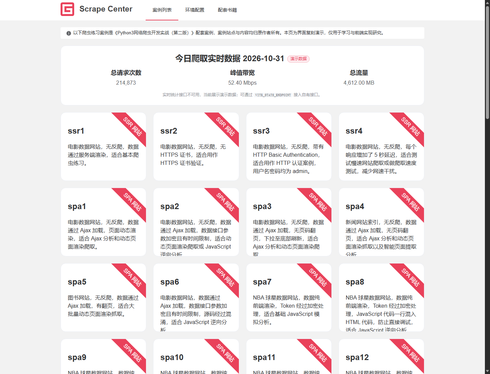
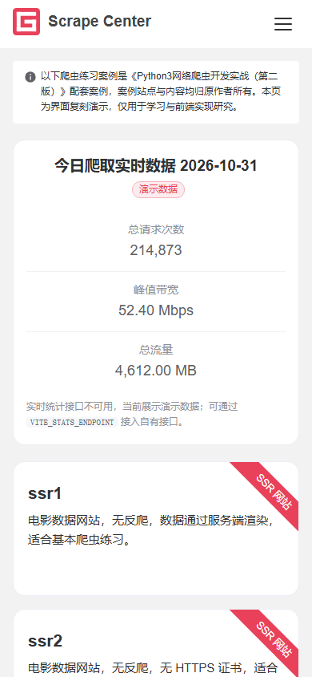

# Scrape Center Portal — 复刻版

对 `https://scrape.center/` 首页的逆向复刻：保留原有的 75% 居中栅格、白色 60px 头部、`#e9415a` 主色、15px 圆角卡片与右上角 45° 分类丝带，并用 Vue 3 组件化重写。

| 桌面端 | 移动端 |
|---|---|
|  |  |

## 在线访问

**https://zippy-cuanxi.github.io/scrape-center-clone/**

仓库：https://github.com/Zippy-cuanxi/scrape-center-clone

部署方式为 **GitHub Actions 构建 + GitHub Pages 发布**（Pages Source 设为 GitHub Actions，而非 `gh-pages` 分支）。每次推送到 `main` 会自动触发 `.github/workflows/deploy.yml`：

1. `npm ci` 安装依赖；
2. 以 `BASE_PATH=/scrape-center-clone/` 执行 `npm run build`，Vite 会把 JS/CSS/favicon 改写成仓库子路径；
3. 产物 `dist/` 通过 `upload-pages-artifact` 上传，再由 `deploy-pages` 发布。

`dist/` 不进入版本库。fork 后若仓库名不同，工作流会自动使用当前仓库名作为子路径，无需改代码。

## 快速开始

```bash
npm install
npm run dev      # http://localhost:5173
npm run build    # 输出到 dist/
npm run preview  # 预览生产构建
```

要求 Node.js 20.19+（开发使用 Node 26 验证）。

## 技术栈

- Vue 3（`<script setup>` 单文件组件）
- Vite 7
- 原生 CSS + 设计令牌（无 UI 框架）
- 无路由依赖：单页目录，锚点导航

## 目录结构

```
src/
├─ App.vue                     # 页面骨架：Header + 告警 + 统计 + 案例网格 + Footer
├─ main.js
├─ components/
│  ├─ AppHeader.vue            # 桌面横向导航 + 移动端汉堡菜单
│  ├─ AppFooter.vue            # 版权与来源说明
│  ├─ SiteLogo.vue             # 内联 SVG 站标（不依赖外部图片）
│  ├─ AlertBanner.vue          # 顶部说明条
│  ├─ StatsPanel.vue           # 今日访问指标卡（加载态 / 演示态）
│  └─ CaseCard.vue             # 案例卡片、分类丝带、桌面内滚动
├─ composables/
│  └─ useSiteStats.js          # 指标加载与展示格式化
├─ services/
│  └─ stats.js                 # 统计接口、双格式解析、演示数据回退
├─ data/
│  ├─ cases.js                 # 54 条案例（从参考站 bundle 原样提取）
│  └─ site.js                  # 站点文案与导航配置
└─ styles/
   ├─ tokens.css               # 颜色 / 圆角 / 间距 / 字体令牌
   └─ base.css                 # reset、容器、通用工具类
```

## 数据与接口

案例清单是构建期常量，共 54 条、9 个分类，顺序与参考站一致：

| 分类 | 数量 |
|---|---|
| SPA 网站 | 16 |
| 反爬网站 | 10 |
| App | 9 |
| 验证码网站 | 8 |
| SSR 网站 | 4 |
| 模拟登录网站 | 3 |
| App 极简样例 | 2 |
| WebSocket | 1 |
| 工具网站 | 1 |

### 统计数据

参考站的 `GET /api/v1/query` 目前在源站返回 524，已不可用。本项目默认展示**确定性演示数据**，并在卡片标题旁标注“演示数据”。

接入真实接口：

```bash
# .env.local
VITE_STATS_ENDPOINT=https://your-host/api/v1/query
```

接口需允许跨域（或与站点同源）。支持两种响应：

```json
{ "date": "2026-10-31", "request": 214873, "bandwidth": 52400000, "flux": 4612000000 }
```

```json
{
  "Data": [{
    "EcdnData": {
      "Metrics": ["flux", "bandwidth", "request"],
      "DetailData": [{ "Time": "2026-10-31 12:35:00", "Value": [4612000000, 52400000, 214873] }]
    }
  }]
}
```

第二种即参考站使用的腾讯云 ECDN `DescribeEcdnStatistics` 结构。解析时会优先按 `Metrics` 名称取下标，缺省时回退到 `[flux, bandwidth, request]` 的位置约定，避免原站“顺序一变数据全错”的隐式契约问题。

## 相对参考站的实现调整

保持外观与信息结构一致的前提下，做了少量工程质量修正：

1. **移动端导航**：参考站在窗口宽度 ≤700px 时直接隐藏菜单，且宽度判断只计算一次。这里改为汉堡菜单，支持 Escape 关闭、跨断点自动收起、`aria-expanded` 状态。
2. **响应式容器**：桌面维持 75% / 最大 1440px；≤1100px 收窄为 90%；≤640px 全宽加 16px 内边距。
3. **卡片滚动**：桌面保留 200px 固定高度与隐藏滚动条，但将丝带移出滚动区，滚动正文时分类标签不会跟着跑；移动端改为自适应高度，避免文字被截断。
4. **统计降级**：接口失败不再静默消失，而是回退到演示数据并明确标注，同时输出控制台警告。
5. **可访问性**：补充 `h1`、`aria-current`、跳转链接的可见焦点、`prefers-reduced-motion` 支持；导航按钮具备完整 ARIA 状态。
6. **页脚归属**：不复制原站备案号与版权署名，改为明确标注“复刻演示、非官方站点”，并保留原站入口。

## 响应式断点

| 断点 | 行为 |
|---|---|
| ≥ 1200px | 容器 75%（最大 1440px），4 列卡片 |
| 992–1199px | 4 列卡片 |
| 641–991px | 2 列卡片 |
| ≤ 640px | 单列、容器全宽、统计指标纵向堆叠、汉堡导航 |

## 已知说明

- 案例链接指向 `*.scrape.center` 原站，属第三方内容，可用性由原站决定。
- 演示数据为固定快照（日期取当天），不代表真实流量，仅用于呈现组件形态。
- 站标为按原站几何比例重绘的内联 SVG，未使用原站图片文件。
